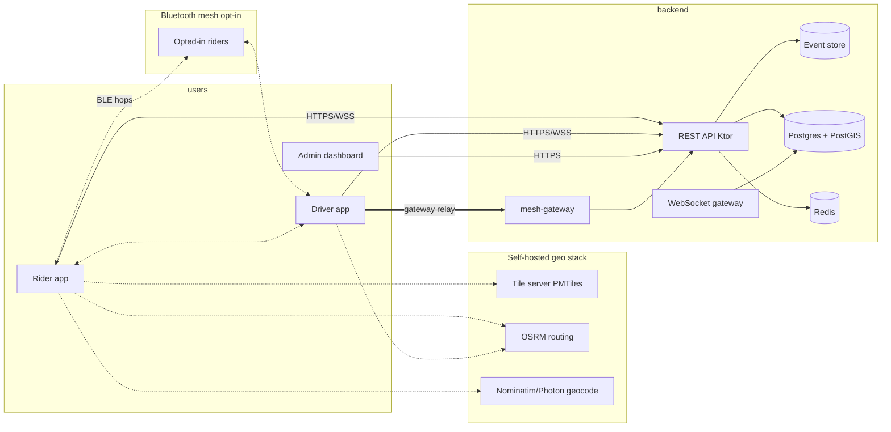
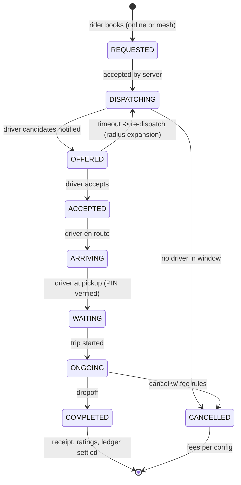
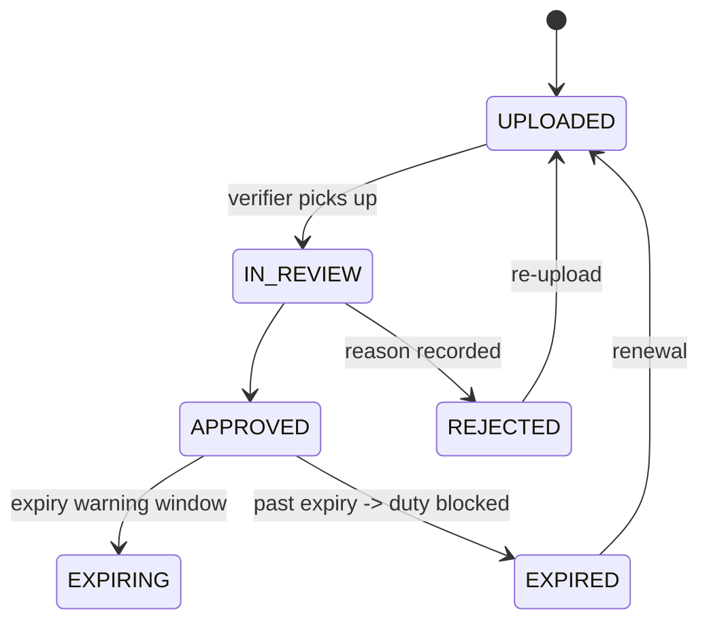
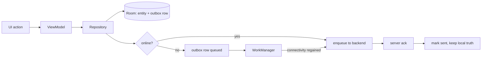
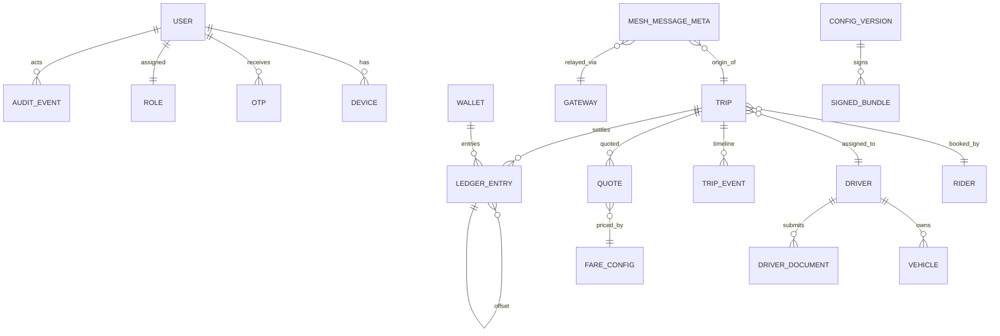

# ARCHITECTURE

v0.1 (Phase 0). Pre-code deliverable per Part B. Will be versioned as phases land; changes require a DECISIONS.md entry.

## System overview

Fully self-hosted, FLOSS-only platform. Offline-first Android apps, Ktor backend on PostgreSQL+PostGIS and Redis, React admin, self-hosted geo stack (MapLibre tiles, OSRM, Nominatim/Photon), WebSocket realtime, and an opt-in Bluetooth multi-hop mesh for offline booking. Every state change flows through an append-only, hash-chained event store (auditability). Offline-originated trips are invisible to drivers by design (driver blindness) and visible only in admin-only tables.

## Repository layout

```
/android            Kotlin/Compose apps (rider + driver modes), includes /android/mesh-android
/backend            Ktor services: api, mesh-gateway, ws-gateway
/admin-web          React + TS + Vite admin
/mesh-core          pure Kotlin/JVM mesh (protocol, crypto, routing, sim) - zero Android imports
/e2e                cross-actor orchestrator (2 emulators + admin browser)
/tools/test-viewer  live/replay evidence viewer (Node + Express + WS)
/tools/report       report gallery generator
/tools/report       storyboard helper source for androidTest + playwright
/tools/sim-bridge   host-side bridge applying mesh topology to emulator runs
/infra              docker-compose, tile pipeline (Planetiler), data fetch scripts
/scripts            operational scripts (seed, emulators, artifacts, ci-local)
/docs               specs, audits, runbooks, evidence
```

## Context diagram



## Container notes

- Backend: Ktor (Kotlin), modular services, Testcontainers for integration tests, Flyway migrations (up/down tested).
- Realtime: WS gateway with topic-per-actor; event catalog below; heartbeat + resume with cursor.
- Admin: React+TS+Vite, Playwright + axe tests, same REST API, server-side RBAC.
- Android: min SDK 26, Compose + Material 3, MVVM + Clean Architecture, Hilt, Room(+FTS), DataStore, WorkManager, Retrofit/Ktor, outbox pattern for every write.
- Geo: tile server serves PMTiles/MBTiles built with Planetiler from a small city extract; OSRM for routing; Nominatim/Photon for geocoding; ODbL attribution everywhere.

## Trip state machine



## Driver duty state machine

```mermaid
stateDiagram-v2
    [*] --> OFFLINE
    OFFLINE --> ONLINE: duty on (verified + docs valid)
    ONLINE -> ONLINE: accepting requests (always connected)
    ONLINE --> DEGRADED: connection lost
    DEGRADED --> ONLINE: reconnect within grace
    DEGRADED --> OFFLINE: grace period expires (stops beaconing)
    OFFLINE --> [*]
```

## Document verification state machine



## Mesh message lifecycle

```mermaid
stateDiagram-v2
    [*] -> CREATED: origin builds envelope (signed, E2E encrypted)
    CREATED -> HOPPING: relay forwards (hopCount+1, breadcrumb+MAC)
    HOPPING -> HOPPING: max maxHops-1 more hops
    HOPPING -> DELIVERED: dest receives + verifies + ACKs
    HOPPING -> EXPIRED: ttl/maxHops exhausted
    DELIVERED -> [*]
    EXPIRED -> [*]
    note right of HOPPING
      duplicates deduped by seen-cache(msgId, originId)
      return leg: source-routed best path + backup,
      per-hop HOP_ACK, ROUTE_ERROR on failure
    end note
```

## Offline outbox pattern



## Core ER diagram (Phase 1 subset)



## WebSocket event catalog (initial)

| Topic | Event | Payload (shape) | Producer | Consumers |
|---|---|---|---|---|
| trip:{id} | trip.updated | status, driverPos, etaS | backend | rider, driver, admin |
| trip:{id} | trip.message | chat message envelope | rider/driver | rider, driver |
| driver:{id} | duty.changed | status | backend | admin |
| dispatch:{driverId} | dispatch.offer | tripBrief (identical for online/offline origin) | backend | driver |
| dispatch:{driverId} | dispatch.expired | offerId | backend | driver |
| admin:live | map.delta | upserts/removals (incl. offline riders w/ hops+path) | backend | admin |
| admin:mesh | mesh.delta | nodes, links, request/quote paths | backend | admin |
| config | config.updated | version + bundle hash | backend | all apps |
| user:{id} | notification.new | notification envelope | backend | apps |

Offline-originated dispatch events carry no origin field (driver blindness; X-05 contract tests enforce).

## Pricing flow (estimate vs final)

```mermaid
sequenceDiagram
    participant R as Rider
    participant B as Backend
    participant G as Gateway driver (mesh)
    R->>R: estimate (online: OSRM+fare config; offline: cached bundle + best distance)
    Note over R: "Estimated price. This is not the final price."
    R->>B: booking (online) or R->>G->>MG->>B (mesh hops)
    B->>B: compute signed final quote (validity window, upfront or metered-with-cap)
    B-->>R: quote (online) or B->>MG->>G->>mesh->>R (best path)
    R->>B: QUOTE_ACCEPT (same return path)
    B->>B: wallet hold, dispatch (driver sees no origin)
```

## Security architecture summary

AuthN: phone/email+password and OTP via pluggable providers (dev inbox adapter in dev/test); JWT access + rotating refresh; argon2id. AuthZ: server-side RBAC. Audit: append-only hash-chained event store, verifiable chain. Documents: encrypted at rest, viewer-only access by role. PII minimization in logs; GDPR export/delete with legal hold. Mesh: Ed25519 identity registered at login, E2E payload encryption, rotating pseudonyms, revocation list, signed config bundles with anti-rollback. Full detail: /docs/THREAT_MODEL.md.

## Honest limits

- BLE multi-hop only works with dense, slow-moving, opted-in devices; range 10-100 m; Android background limits and OEM battery killers constrain reliability. Documented in MESH_LIMITS.md (Stage 7) and surfaced in the in-app diagnostics.
- Emulators cannot run Bluetooth; only SimulatedMeshTransport runs on emulators/CI. BLE claims require physical-device evidence (Stage 6).
